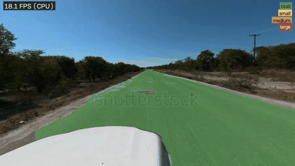

# road-pothole-seg



Real-time road and pothole **instance segmentation on CPU**, packaged as a small Python
library. A YOLO26n-seg model, exported to ONNX, segments the drivable road and every
pothole in any video frame. The package then measures each pothole (area, severity) and
tracks it across frames with ByteTrack, so one pothole gets one ID. It runs on ONNX
Runtime alone: no PyTorch, no GPU, three dependencies (numpy, opencv-python, onnxruntime).

## Install

```bash
pip install git+https://github.com/ngtdat9/road-pothole-seg.git@v1.0
```

Download a model from the [v1.0 release](https://github.com/ngtdat9/road-pothole-seg/releases/tag/v1.0):
`baseline-640.onnx` (most accurate), `baseline-480.onnx` (faster) or `baseline-320.onnx`
(fastest, misses small potholes). Python 3.10+.

## Quick start

One image:

```python
import cv2
from road_pothole_seg import PotholeTracker, Segmenter, analyse_potholes

segmenter = Segmenter("baseline-640.onnx")
seg = segmenter(cv2.imread("road.jpg"))  # any HxWx3 BGR frame, any size
for p in analyse_potholes(seg):          # one measured Pothole per mask
    print(p.severity, p.area_frac, p.bbox_xyxy)
```

A video, with one ID per pothole (a new pothole gets its ID on its second frame):

```python
tracker = PotholeTracker(frame_rate=30)
cap = cv2.VideoCapture("road.mp4")
while True:
    ok, frame = cap.read()
    if not ok:
        break
    for p in tracker.update(analyse_potholes(segmenter(frame))):
        print(p.track_id, p.severity)
```

The demo app does the same and writes an overlay video and a CSV with one row per pothole:

```bash
git clone https://github.com/ngtdat9/road-pothole-seg.git && cd road-pothole-seg
pip install -e ".[demo]"                          # put the .onnx files in models/
python -m apps.run_video --source road.mp4 --save out.mp4 --csv potholes.csv
```

## API

The four public names are frozen for v1.x: new features arrive only as optional arguments.

**`Segmenter(model_path, input_size=None, conf=0.25, mask_threshold=0.5, iou=0.5, fill_road=True, providers=None)`**
Callable on a BGR frame of any size; letterboxes internally and returns a
`Segmentation` whose masks are at the original frame size:
- `road_mask`: H×W bool. With `fill_road`, potholes are part of the road (no holes).
  All False when no road is visible.
- `pothole_masks`: one H×W bool mask per pothole, and `scores`, their confidences.

`input_size=None` reads it from the model. `providers` picks ONNX Runtime execution
providers (default CPU). `last_timings_ms` holds the latency of the last call per stage.

**`analyse_potholes(seg, metres_per_px=None, severity_bins=None, min_part=0.1)`** →
`list[Pothole]`. Cleans each mask (drops specks, fills holes) and measures it.
Each `Pothole` has `mask`, `score`, `bbox_xyxy`, `area_px`, `area_frac` (share of the
frame), `center_px`, `severity` (`small` / `medium` / `large`) and `track_id` (-1 until
tracked). `area_m2` is filled only when you pass `metres_per_px`, which is valid only
for a camera looking straight down; on dashcam frames leave it `None`.

**`SeverityBins(frac=(0.0012, 0.0066), m2=(0.1, 0.5))`**: upper bounds of `small` and
`medium`. Without a scale, severity uses `area_frac` (defaults: the thirds of labelled
pothole sizes in the training set); with `metres_per_px` it uses square metres.

**`PotholeTracker(frame_rate=30.0, track_thresh=0.4, match_iou=0.2, low_match_iou=0.5, lost_seconds=1.0, min_hits=2, match_buffer=0.3)`**
ByteTrack in numpy. `update(potholes)` returns the potholes that belong to a confirmed
track, with `track_id` set; a new pothole gets its ID after `min_hits` frames, and an ID is
kept through gaps up to `lost_seconds`. `first_seen(track_id)` gives the frame a track
was first detected. Create one tracker per video stream.

All defaults equal [`configs/pipeline.yaml`](configs/pipeline.yaml); the package never
reads files itself.

## Results

**Data.** Three public Roboflow datasets (below) merged to 3,140 images with two classes,
`road` and `pothole`. Near-duplicates were removed by perceptual hashing (634 images) before
a seeded 70/15/15 split grouped by source video: 2,196 train, 471 val, 473 test. Road on the
pothole-only set was pseudo-labelled by a road model and checked by eye.

**Accuracy** (mask mAP, test split, opened once after choosing the model on val):

| Input size | Pothole mAP50 | Pothole mAP50-95 | Road mAP50-95 |
|---|---|---|---|
| 640 | **0.720** | **0.401** | 0.806 |
| 480 | 0.694 | 0.372 | 0.818 |
| 320 | 0.593 | 0.303 | 0.809 |

Test matches val (0.722 / 0.408), so choosing on val did not overfit. A small model and
two tuning runs all scored within 0.01 of the nano model, so the limit is the data, not
the settings. The ONNX export is lossless (same val scores as PyTorch with square input),
and the package's masks match Ultralytics' own on the same model (mean mask IoU 1.000 on
80 frames in four aspect ratios).

**Why de-duplication matters.** A model trained on a naive merge (duplicates kept, random
split) scores 0.780 mAP50 on its own test split, but 0.714 on the clean test, the same as
the de-duplicated model (0.720). A naive merge overstates pothole mAP50 by about 0.07 (9%)
while adding no real accuracy.

**Speed** (full pipeline per frame: preprocess, ONNX inference, mask decoding, measuring,
tracking; 1280×720 road video, ONNX Runtime 1.32 on CPU, default threads):

| Machine | 640 px | 480 px | 320 px |
|---|---|---|---|
| MacBook, Apple M1 (8 cores) | **16.7 FPS** (60 ms) | 25.1 FPS (40 ms) | 50.5 FPS (20 ms) |

Inference is about 85% of the time at 640. Reproduce with
`python -m benchmarks.fps --source road.mp4 --name my-machine`.

**Tracking** (synthetic clips from 20 val images with known pothole tracks): no ID
switches; 74% of frames where a labelled pothole is visible have a tracked pothole
(detector alone 81%: a new pothole waits one frame for its ID).

## Limitations

- **Small, distant potholes** are often missed in a single frame (recall 0.55 for potholes
  under 0.1% of the frame, 0.90 for large ones). On video they are usually picked up as
  the car gets closer.
- **Size is an estimate.** Masks match hand labels at IoU ~0.78, so area and severity are
  rough (about ±20%). On dashcam video, severity reflects size in the frame, so a pothole
  grows from `medium` to `large` as you approach; the CSV keeps its largest size.
- **Look-alikes:** water-filled potholes, long cracks and patched asphalt are confused with
  potholes in both directions. Some training labels are wrong (cracks, vehicles).
- Trained on ground-level photos and dashcam video; top-down (drone) views are not
  covered by this model.

Details: [`docs/failures.md`](docs/failures.md), all experiments in
[`docs/results.md`](docs/results.md).

## Datasets

| Dataset | Version | License |
|---|---|---|
| [Potholes and Roads Instance Segmentation](https://universe.roboflow.com/road-dataset-rpv8i/potholes-and-roads-instance-segmentation-nga49) | v1 | CC BY 4.0 |
| [road segmentation (university-evipv)](https://universe.roboflow.com/university-evipv/road-segmentation-onvjk) | v2 | CC BY 4.0 |
| [Pothole Segmentation (GNSoft2)](https://universe.roboflow.com/gnsoft2/pothole-segmentation-7fnkw) | v2 | CC BY 4.0 |

Sources, counts, quality checks and every keep/drop decision: [`docs/datasets.md`](docs/datasets.md).
The model is fine-tuned from [Ultralytics](https://github.com/ultralytics/ultralytics) YOLO26n-seg.

## Repository

```
road_pothole_seg/   the package (numpy, opencv, onnxruntime only)
apps/               run_video.py (overlay + CSV), make_demo.py (GIF)
benchmarks/         fps.py (latency per stage), track_sim.py (tracker check)
training/           Colab training, merge, evaluation and ONNX export scripts
configs/            pipeline.yaml (run-time settings), train/merge/export settings
docs/               datasets, results, failure analysis, weekly log
```

Development: `pip install -e ".[dev]"`, then `pytest` and `ruff check .`.
